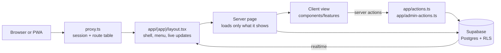
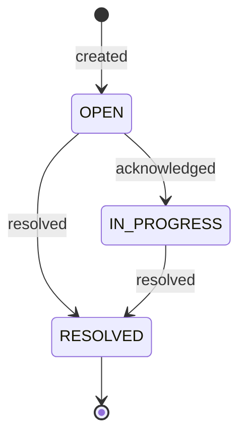
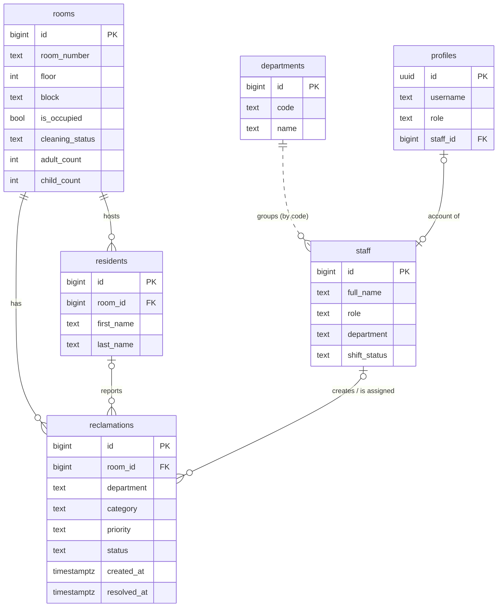

# Hotel SES

Operations app for Hôtel Méditerranée Thalasso Golf Hammamet (340 rooms). Front desk, HR, management and the administrator track rooms, guest requests and staff in real time, from a phone or a desktop. The interface is in French.

Built with Next.js 16, React 19, Supabase and the [easyui](https://easyui.site) component set. Installable as a PWA.

## Pages

Everyone signs in with a personal account (username + password). The role of the account decides which pages and actions it gets; there is one app and one menu, filtered by role.

| Route | Page | Roles |
| --- | --- | --- |
| `/dashboard` | Front desk (reception) or management (direction) overview | reception, gm, admin |
| `/rooms` | Room plan by floor, block and side, with filters | all |
| `/rooms/[number]` | One room: stay, cleaning, requests, history, trends | all |
| `/requests` | Requests list with filters | all |
| `/requests/[id]` | One request: edit, or read-only without the right | all |
| `/staff` | Staff directory | rh, admin |
| `/staff/shifts` | Weekly roster | rh, admin |
| `/staff/services` | Services (departments) | rh, admin |
| `/analytics` | Rooms and requests charts; room trends (gm); headcount (rh) | all |
| `/admin/accounts` | Accounts | admin |
| `/admin/rooms` | Room inventory (« Parc des chambres ») | admin |
| `/settings`, `/account/password` | Theme, account, password change | any signed-in account |
| `/login`, `/privacy`, `/tos`, `/offline` | Public pages | everyone |

Home after sign-in: `/dashboard` for reception, direction and admin; `/staff` for HR. A page the role may not open redirects to its home.

**Details as URLs.** From a list, `/rooms/3077` and `/requests/291` open as a modal over the page (Back closes it); a refresh or a shared link shows the same detail as a full page (Next.js parallel and intercepting routes, `app/(app)/@modal`).

**Filters in the URL.** Search, floor, block, status, service, role and sort live in the query string (`/rooms?floor=3&status=DIRTY`), so refresh, Back and shared links keep them (`hooks/useUrlFilters.ts`).

## Who can do what

One table, `lib/permissions.ts`, drives the proxy, the pages, the menus, the buttons and the server actions. The admin has every capability. The database rules (`supabase/migrations_accounts.sql`) enforce the same split again.

| Capability | Reception | HR | Direction |
| --- | :---: | :---: | :---: |
| Dashboard | yes | | yes |
| See rooms and requests | yes | yes | yes |
| Check guests in and out, guest counts | yes | | |
| Advance the cleaning cycle | yes | yes | yes |
| Create a request or record a past incident | yes | yes | yes |
| Quick « Créer la demande » button on every page | yes | | |
| Acknowledge a request | yes | | |
| Resolve a request | yes | | yes |
| Edit or delete a request | yes | | yes |
| Analytics | yes | yes | yes |
| Room trends (rush hour, repeat problems) | | | yes |
| Headcount by service | | yes | |
| Staff, shifts, absences, services | | yes | |
| Accounts and room inventory | admin only | | |

Every server action starts with `deny("capability")` (`lib/server/session.ts`), so a hidden button is never the only guard.

## How it works



| Step | Where | What happens |
| --- | --- | --- |
| 1 | `proxy.ts` | Verifies the Supabase session, enforces the temporary-password change, checks the route against `lib/routes.ts` |
| 2 | `app/(app)/layout.tsx` | One shell for every role: sidebar (bottom bar on phones), messages, the front desk's quick forms, one realtime subscription |
| 3 | `app/(app)/*/page.tsx` | Each page checks its route (`requireRoute`) and loads its own data (`utils/loadHotelData.ts`) |
| 4 | `app/actions.ts`, `app/admin-actions.ts` | Every change is a server action guarded by a capability; the screen updates at once and reverts if the server refuses |
| 5 | `components/app/RealtimeRefresh.tsx` | Changes to `rooms`, `reclamations`, `staff` and `departments` refresh open pages |

## Requests



A request counts as open until it is resolved. `ACKNOWLEDGED` exists in the schema; acknowledging moves a request straight to `IN_PROGRESS`.

**Assignment.** A new request goes to the first staff member of its service who is present; failing that, for Technical and Housekeeping, to a present member with the service's fallback role (`maintenance`, `governance`). Otherwise it stays unassigned until someone edits it.

| Field | Values |
| --- | --- |
| Priority | Normale, Haute, Urgente (`STANDARD`, `HIGH`, `EMERGENCY`) |
| Status | Ouverte, En cours, Résolue |

**Room tiles** show the one thing that needs action first: an urgent request, then other open requests, then cleaning (dirty, cleaning, inspecting), then occupied or ready.

## Data model



## Getting started

Requirements: Node.js 20.9 or newer (Next.js 16) and a Supabase project.

```bash
git clone https://github.com/Qirto/hotel-ses.git
cd hotel-ses
npm install
cp .env.example .env.local   # then fill in the values
npm run dev                  # http://localhost:3000
```

### Environment variables

| Variable | Purpose |
| --- | --- |
| `NEXT_PUBLIC_SUPABASE_URL` | Supabase project URL |
| `NEXT_PUBLIC_SUPABASE_PUBLISHABLE_KEY` | Supabase publishable key |
| `SUPABASE_SECRET_KEY` | Server only: account management (Supabase → Project settings → API keys → secret key). Put it in `.env.local` (gitignored) and the host's environment, **never** in a committed file and never with a `NEXT_PUBLIC_` prefix |

### Database

Run these in the Supabase SQL editor, in order:

| Order | File | Adds |
| --- | --- | --- |
| 1 | `supabase/hotel_rooms.sql` | Tables, policies and the 340 rooms |
| 2 | `supabase/migrations_roles_upgrade.sql` | Guest counts, staff presence, SLA deadline |
| 3 | `supabase/migrations_department_crud.sql` | `departments` table |
| 4 | `supabase/migrations_expand_departments.sql` | All hotel services and staff roles |
| 5 | `supabase/migrations_accounts.sql` | `profiles` (accounts) and access rules by role; anonymous visitors get nothing |
| 6 | `supabase/migrations_realtime.sql` | Live updates: adds rooms, requests, staff and services to the realtime publication |

### Accounts

| Item | Detail |
| --- | --- |
| Sign-in | Username + password (Supabase Auth). Usernames map to an internal address `<username>@staff.hotel-ses.local`; no email is ever sent |
| Roles | `reception`, `rh`, `gm`, `admin`, stored in the signed session (`app_metadata.role`, writable only with the secret key) and mirrored in `profiles` |
| New account | Created with a temporary password; the person must set their own at first sign-in before any page opens |
| Forgotten password | The admin resets it (new temporary password) from Comptes |
| Disable | The admin disables an account (sign-in refused) and can re-enable it; the last active admin cannot be removed |

First administrator, once, after the migrations:

```bash
npm run account:create -- --username a.admin --role admin --name "Prénom Nom"
```

Demo accounts, one per role: `npm run seed:accounts`. Their passwords go to `demo-accounts.local.txt` (gitignored), never to the terminal.

### Scripts

| Command | Does |
| --- | --- |
| `npm run dev` | Dev server with hot reload |
| `npm run build` | Production build (includes the type check) |
| `npm run start` | Serve the production build |
| `npm run seed` | Add any missing rooms of the hotel plan (`scripts/room_layout.js`) |
| `npm run seed:demo` | Demo staff, guests and ~90 days of requests (additive; `--reset` to start over) |
| `npm run account:create` | Create one account |
| `npm run seed:accounts` | Demo accounts, one per role |
| `node scripts/tunisian_names.mjs` | Rename existing staff, guests and heads of service with Tunisian names, in place |
| `node scripts/test_compliance_endpoints.js [url]` | Security headers, legal pages and sign-in redirects of a running instance; exits 1 on failure |

## Design

| Area | Choice |
| --- | --- |
| Components | easyui.site (copied into `components/ui`), shared views in `components/features` |
| Theme | easyui monochrome tokens, dark and light, defined once in `app/globals.css` |
| Icons | lucide, mapped per service and issue type in `lib/icons.tsx` |
| Lists | One `DataTable` everywhere: columns on desktop, a stacked list on phones (name, details, actions) |
| Navigation | Sidebar on desktop with an « Administration » group; bottom bar on phones, with « Plus » past five entries |
| Language | French with French typography (’ and a narrow no-break space before `: ; ! ?`) |
| Accessibility | WCAG AA contrast in both themes, skip link, reduced motion respected |

## Stack

| Layer | Technology |
| --- | --- |
| Framework | Next.js 16 (App Router, Turbopack, `proxy.ts`) |
| UI | React 19, Tailwind CSS 4, easyui, Framer Motion, lucide |
| Data | Supabase Postgres with row-level security, Auth, Realtime, `@supabase/ssr` |
| Language | TypeScript |
| Hosting | Vercel |
| Offline | Serwist service worker (`app/sw.ts`), web manifest, install prompts |

## Legal

`/privacy` and `/tos` describe what the app does today: the data it stores, Tunisian data-protection law (loi organique n° 2004-63, INPDP), the session cookie and browser storage. Keep them in step when that changes; `scripts/test_compliance_endpoints.js` checks the essentials.

## Known limitations

| Issue | Risk | Fix |
| --- | --- | --- |
| `.env` and `.env.production` are tracked in git | Old passcodes (no longer used) remain in the history | Remove them from git; keep values in `.env.local` and the host |
| Phones render a table first, then switch to the list | A brief layout change on first load | Pick the layout with CSS breakpoints instead of a measured width |
| The weekly roster is not saved | Changes stay on the device | Store shifts in the database |

## License

Proprietary software for hotel operations. Third-party licenses are listed in [LICENSES.md](LICENSES.md).
