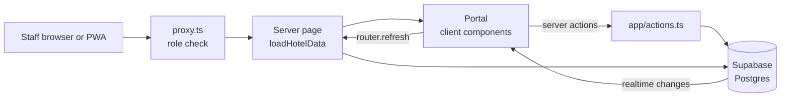
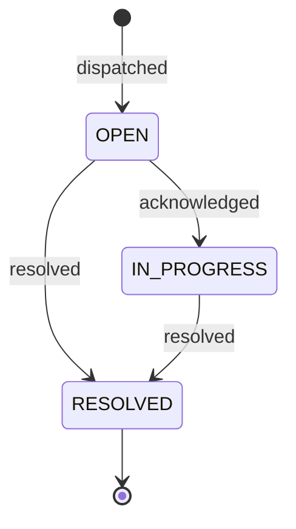
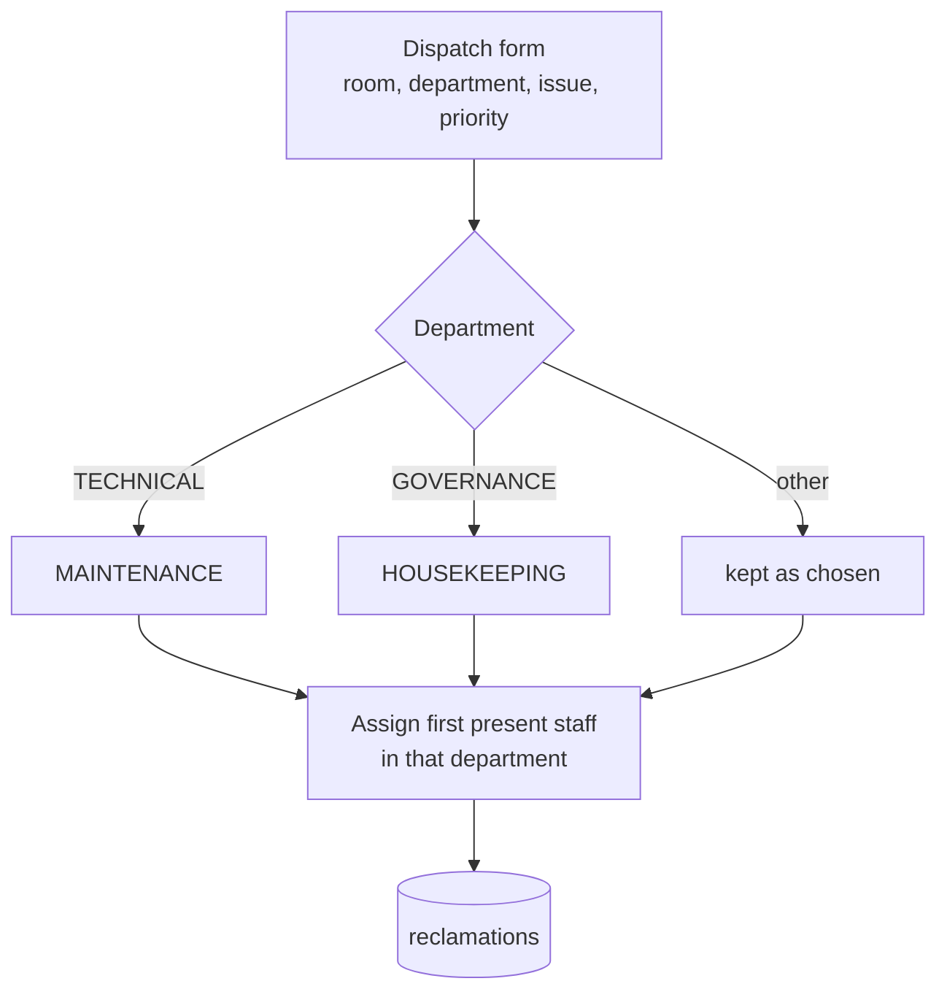
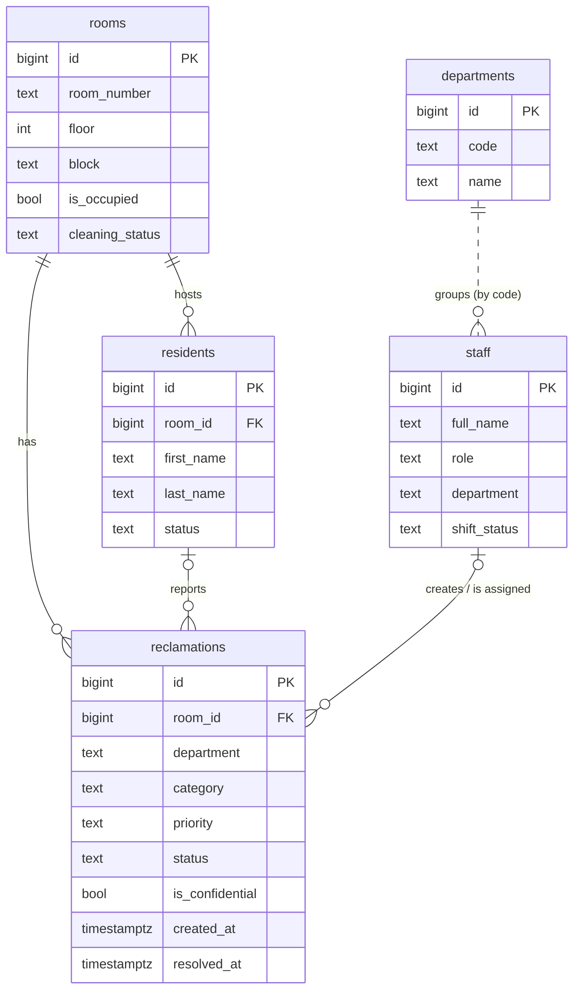

# Hotel SES

Operations app for Hôtel Méditerranée Thalasso Golf Hammamet (340 rooms). Front desk, HR and management track rooms, guest issues ("tickets") and staff in real time, from a phone or a desktop.

Built with Next.js 16, React 19, Supabase and the [easyui](https://easyui.site) component set. Installable as a PWA.

## Portals

Each staff member signs in with a personal account (username + password) and lands in the portal of their role. The admin opens every portal.

| Portal | Route | Role | Tabs |
| --- | --- | --- | --- |
| Reception | `/reception` | `reception` | Overview, Rooms, Tickets, Stats |
| General Manager | `/gm` | `gm` | Dashboard, Rooms, Tickets, Analytics |
| Human Resources | `/rh` | `rh` | Staff (directory, shifts, services), Rooms, Tickets, Analytics |
| Administration | `/admin` | `admin` | Accounts, Rooms (plan + inventory), Tickets, Staff & services, Portals |

Other pages: `/login`, `/compte/mot-de-passe` (password change), `/settings`, `/offline`, `/privacy`, `/tos`.

### What each portal can do

| Action | Reception | GM | HR |
| --- | :---: | :---: | :---: |
| See every room and its status | yes | yes | yes |
| Check guests in and out | yes | | |
| Advance the cleaning cycle | yes | yes | yes |
| Dispatch a new ticket | yes | yes | yes |
| Record a past incident | yes | yes | yes |
| Acknowledge a ticket | yes | | |
| Resolve a ticket | yes | yes | |
| Room analytics (rush hour, repeat problems) | yes | yes | yes |
| Manage staff, shifts and absences | | | yes |
| Edit, reassign or delete a ticket | yes | yes | |
| Manage services (departments) | | | yes |
| Manage accounts and the room inventory | admin only | | |

The admin can do everything above. Each action checks the caller's role on the server (`deny()` in `lib/server/session.ts`), and the database rules check it again.

## How it works



| Step | Where | What happens |
| --- | --- | --- |
| 1 | `proxy.ts` | Refreshes and verifies the Supabase session; sends visitors without the right role to `/login` (or their own portal) |
| 2 | `app/<portal>/page.tsx` | Loads rooms, staff, residents, departments and tickets on the server |
| 3 | `app/components/*Portal.tsx` | Renders the portal from shared views in `components/features` |
| 4 | `app/actions.ts` | Every change (dispatch, resolve, check-in, shifts) is a server action |
| 5 | `hooks/useRealtimeRefresh.ts` | Database changes refresh every open portal |

Realtime subscriptions per portal:

| Portal | Tables |
| --- | --- |
| Reception | `rooms`, `reclamations` |
| GM | `rooms`, `reclamations` |
| HR | `staff`, `departments`, `reclamations` |

## Tickets

### Lifecycle



A ticket counts as **open** until it is resolved. `ACKNOWLEDGED` exists in the schema, but acknowledging currently moves a ticket straight to `IN_PROGRESS`.

### Dispatch



| Field | Values |
| --- | --- |
| Priority | Standard, High, Emergency |
| Status | Open, Acknowledged, In progress, Resolved |
| Confidential | Stored flag on the ticket; the current forms always send `false` |

### Room status

Each room tile shows the one thing that needs action first.

| Shown | When |
| --- | --- |
| Urgent issue | An open High or Emergency ticket |
| N open issues | Any other open ticket |
| Dirty / Cleaning / Inspecting | Not clean yet |
| Occupied / Ready | Otherwise |

## Data model



## Getting started

Requirements: Node.js 20.9 or newer and a Supabase project.

```bash
git clone https://github.com/Qirto/hotel-ses.git
cd hotel-ses
npm install
cp .env.example .env.local   # then fill in the values
npm run dev                  # http://localhost:3000
```

### Environment variables

| Variable | Purpose |
| --- | --- |
| `NEXT_PUBLIC_SUPABASE_URL` | Supabase project URL |
| `NEXT_PUBLIC_SUPABASE_PUBLISHABLE_KEY` | Supabase publishable key |
| `SUPABASE_SECRET_KEY` | Server only: account management (Supabase → Project settings → API keys → secret key). Put it in `.env.local` (gitignored) and the host's environment, **never** in the committed `.env` |

### Accounts

| Item | Detail |
| --- | --- |
| Sign-in | Username + password (Supabase Auth). Usernames map to an internal address `<username>@staff.hotel-ses.local`; no email is ever sent |
| Roles | `reception`, `rh`, `gm`, `admin`, stored in the signed session (`app_metadata.role`, writable only with the secret key) and mirrored in `profiles` |
| New account | Created with a temporary password shown once; the person sets their own at first sign-in |
| Forgotten password | The admin resets it (new temporary password) from Administration → Comptes |
| Disable | The admin disables an account (sign-in refused) and can re-enable it; the last active admin cannot be removed |

First administrator, once, after the migration:

```bash
npm run account:create -- --username a.admin --role admin --name "Prénom Nom"
```

Demo accounts (one per role) for presentations: `npm run seed:accounts`. Their temporary passwords go to `demo-accounts.local.txt` (gitignored), never to the terminal.

### Database setup

Run these in the Supabase SQL editor, in order:

| Order | File | Adds |
| --- | --- | --- |
| 1 | `supabase/hotel_rooms.sql` | Tables, policies and the 340 rooms |
| 2 | `supabase/migrations_roles_upgrade.sql` | Guest counts, staff presence, confidential flag, SLA deadline |
| 3 | `supabase/migrations_department_crud.sql` | `departments` table |
| 4 | `supabase/migrations_expand_departments.sql` | All hotel departments and roles for staff |
| 5 | `supabase/migrations_accounts.sql` | `profiles` (accounts) and access rules by role; anonymous visitors get nothing |
| 6 | `supabase/migrations_realtime.sql` | Live updates: adds rooms, requests, staff and services to the realtime publication |

`npm run seed` re-seeds the rooms from a script instead of SQL.

### Scripts

| Command | Does |
| --- | --- |
| `npm run dev` | Dev server with hot reload |
| `npm run build` | Production build (includes type check) |
| `npm run start` | Serve the production build |
| `npm run seed` | Add any missing rooms of the hotel plan (scripts/room_layout.js) to Supabase |
| `npm run seed:demo` | Demo staff and tickets (additive; `--reset` to start over) |
| `npm run account:create` | Create one account (first admin) |
| `npm run seed:accounts` | Demo accounts, one per role |

## Design

| Area | Choice |
| --- | --- |
| Components | easyui.site (copied into `components/ui`), shared views in `components/features` |
| Theme | easyui monochrome tokens, dark and light, defined once in `app/globals.css` |
| Icons | lucide, mapped per department and issue type in `lib/icons.tsx` (no emojis) |
| Layout | Sidebar on desktop, top bar and bottom tabs on phones; tables turn into cards when they do not fit |
| Accessibility | WCAG AA contrast in both themes, 40px+ touch targets, skip link, reduced motion respected |

## Stack

| Layer | Technology |
| --- | --- |
| Framework | Next.js 16 (App Router, Turbopack) |
| UI | React 19, Tailwind CSS 4, easyui, Framer Motion, lucide |
| Data | Supabase Postgres, Realtime, `@supabase/ssr` |
| Language | TypeScript |
| Hosting | Vercel (`vercel.json`) |
| Offline | Service worker (`public/sw.js`), web manifest, install prompts |

## Known limitations

These are open and should be fixed before production use with real guest data.

| Issue | Risk | Fix |
| --- | --- | --- |
| `.env` files are tracked in git | The old passcodes (no longer used) are in the history | Remove `.env` / `.env.production` from git; keep secrets in `.env.local` and the host |

## License

Proprietary software for hotel operations. Third-party licenses are listed in [LICENSES.md](LICENSES.md).
